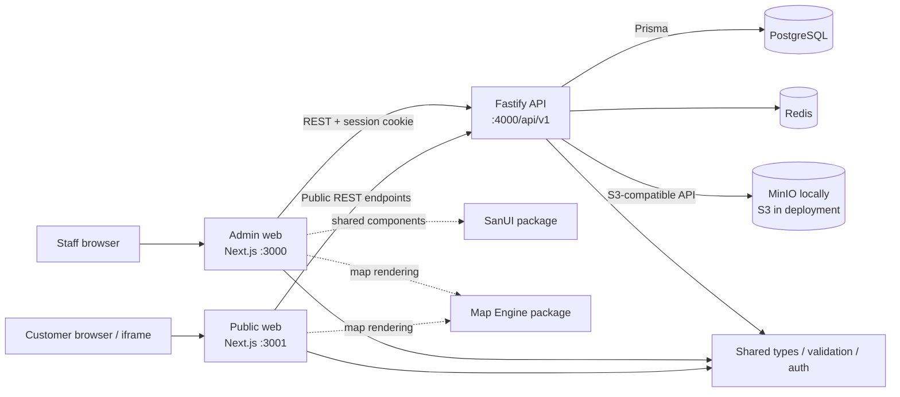

# System architecture

## Big picture

VStudio is a pnpm workspace monorepo orchestrated by Turborepo. It is deployed locally as three JavaScript applications plus supporting services:



`pnpm dev` is the normal local entry point. The root `predev` script builds workspace dependencies before Turbo starts the three apps. Local PostgreSQL, Redis, and MinIO are declared in `infrastructure/docker/compose.yaml`.

## Monorepo layout

```text
apps/
  admin-web/        Staff-facing Next.js application
  public-web/       Customer map and embed Next.js application
  api/              Fastify API, split into feature modules
packages/
  ui/               SanUI shared React component library
  map-engine/       SVG map rendering and geometry interactions
  types/            Shared domain/status types and state transitions
  validation/       Shared Zod request and geometry schemas
  auth/             Central role-to-permission rules
  api-client/       Typed API wrapper used by the web apps
  config/           Environment parsing and validation
  utils/            Formatting helpers and demo fixtures
  eslint-config/    Shared lint configuration
  tsconfig/         Shared TypeScript configurations
database/
  schema.prisma     PostgreSQL model definitions
  migrations/       Checked-in SQL migrations, including tenant RLS
  seed.ts           Repeatable local sample data
infrastructure/docker/compose.yaml
docs/
```

Each workspace package has a `package.json`; internal dependencies use `workspace:*`. Root scripts delegate build, lint, typecheck, and tests through Turbo.

## Main request path

1. A user action in a web page calls a function on `vstudioApi` in `packages/api-client`.
2. The API client sends JSON to `NEXT_PUBLIC_API_URL` with `credentials: 'include'` so the browser sends the session cookie.
3. Fastify validates the request and checks session, role permission, and organization scope.
4. Route modules call Prisma inside a tenant transaction (`withTenant`).
5. Prisma reads/writes PostgreSQL. Mutations that change important state write an audit record; inventory changes may also emit a Redis event.
6. The API serializes a response. TanStack Query refreshes/invalidate cached data in the web app.

## Why the map is not the database

There are three separate concepts:

- **Layout asset:** the uploaded picture/file stored in object storage.
- **Geometry:** the shape drawn on top, stored in the unit record as JSON in layout coordinates.
- **Inventory domain:** database fields such as unit number, type, area, price, status, project, and booking.

The shape points to a unit ID. The SVG is only the editor/viewer layer; it is not a database of plots. This separation allows the same geometry and unit data to display at different screen sizes and zoom levels without saving browser pixel coordinates.

## Map editing flow

```text
Upload image → create upload intent → signed upload to MinIO/S3 → confirm and inspect file
                                                         ↓
Project + layout dimensions ← draw rectangle/polygon in shared coordinate space
                                                         ↓
                                   create unit with geometry + inventory fields
                                                         ↓
                                     save geometry edits through API
```

`packages/map-engine` has no business knowledge such as price or bookings. It accepts dimensions, an image URL, shapes, a selected tool, and callbacks. `apps/admin-web` supplies labels and status colors and owns the unit dialog and save calls.

Map edits temporarily live in the Map Studio Zustand store. Undo/redo snapshots are also client-side. Pressing **Save changes** sends geometry changes to the API, which checks the expected unit version and verifies the geometry fits the layout. If someone else changed that unit first, the API returns a write conflict instead of silently overwriting their work.

## Authentication and tenant isolation

- The API uses argon2id password hashes and short-lived signed session cookies; the cookie is HTTP-only.
- Authenticated requests resolve the session, user, organization membership, and current role in the backend.
- Permission names and role mappings live in `packages/auth`; route handlers enforce permissions. Hiding a button in the frontend is not considered authorization.
- Organization-owned queries use `withTenant`, which sets PostgreSQL transaction-local `app.organization_id` and `app.user_id` settings.
- Migrations enable and force row-level security on tenant tables. Production's API database role must not be a PostgreSQL superuser or table owner because those roles can bypass RLS.
- CORS is allowlisted from `ADMIN_ORIGIN` and `PUBLIC_ORIGIN`; cookie-authenticated writes also check the request origin.

## Local services and future deployment

| Local service | Responsibility | Deployment direction |
| --- | --- | --- |
| PostgreSQL | Durable tenant, project, layout metadata, unit, booking, and audit records | Managed PostgreSQL; retain RLS policy and backups |
| Redis | Realtime event pub/sub and BullMQ background asset work | Managed Redis |
| MinIO | S3-compatible local image storage | Private S3 bucket and least-privilege IAM |
| API process | REST backend and background asset worker | Container on AWS |
| Next.js apps | Admin and public web user interfaces | Container/managed web hosting |

The repository does not currently require Kubernetes. Email delivery, OAuth/SSO, a complete invitations flow, and several production operations still need implementation/configuration; see the root README's security/deployment notes.
